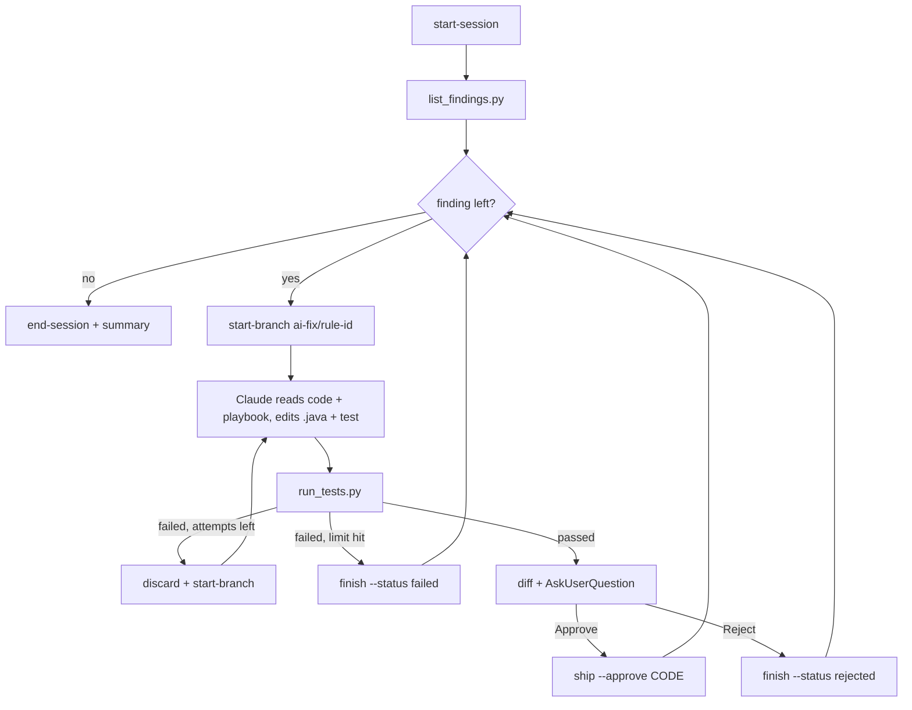

# code-quality-skill

A **plugin for Claude Code, GitHub Copilot CLI and Cursor** that fixes **SonarQube / CodeQL findings** in a Java Maven codebase. For
each finding it makes the smallest safe change, writes a JUnit 5 test, runs the Maven build,
retries on failure and, only after **you approve the diff**, commits the change to an `ai-fix/*`
branch and opens a PR.

It is a port of `code-quality-agent` (LangGraph + MCP + the Claude API) to a skill. Claude Code is
both the model and the orchestrator, so there is no API key, no LangGraph, and no Python packages
to install.

```
/code-quality-fix:code-quality-fix                          # Claude Code (plugin skills are namespaced)
/code-quality-fix:code-quality-fix file 3
/code-quality-fix:code-quality-fix sonar 5 /path/to/service
/code-quality-fix:code-quality-fix codeql 5 /path/to/service
```

In Copilot CLI and Cursor, invoke the `code-quality-fix` skill (for example `/code-quality-fix`) or
just ask: "fix the Sonar findings in this repo".

## Install

Requirements on the machine: Python 3.9+, Java 17+, Maven, git (`gh` only for real PRs), and a
POSIX shell for the hook (macOS / Linux / WSL). Replace `<owner>/code-quality-skill` with the GitHub
repository you push this to.

| Tool | Install |
|---|---|
| **Claude Code** | `/plugin marketplace add <owner>/code-quality-skill` then `/plugin install code-quality-fix@code-quality` (or `claude plugin install code-quality-fix@code-quality` after `claude plugin marketplace add ...`) |
| **GitHub Copilot CLI** | `copilot plugin install <owner>/code-quality-skill:plugins/code-quality-fix`, or `copilot plugin marketplace add <owner>/code-quality-skill` then `copilot plugin install code-quality-fix@code-quality` |
| **Cursor** | Publish the repo (it carries `.cursor-plugin/marketplace.json`) through cursor.com/marketplace/publish or your team's plugin distribution, or for local testing copy `plugins/code-quality-fix` into Cursor's local plugins folder and run *Developer: Reload Window* |
| **Other Agent Skills tools** | Copy `plugins/code-quality-fix/skills/code-quality-fix/` into the tool's skills folder. You get the skill and the script guardrails, but not the hook |

Try it without installing: `claude --plugin-dir ./plugins/code-quality-fix` or
`copilot --plugin-dir ./plugins/code-quality-fix`.

### What each tool loads

| | Claude Code | Copilot CLI | Cursor |
|---|---|---|---|
| Manifest | `.claude-plugin/plugin.json` | same file (Copilot reads the Claude location) | `.cursor-plugin/plugin.json` |
| Marketplace | `.claude-plugin/marketplace.json` | same file | `.cursor-plugin/marketplace.json` |
| Skill | `skills/code-quality-fix/` | same | same |
| Guard hook | `hooks/hooks.json` (`PreToolUse`) | same file (Claude-format hooks) | `hooks/cursor-hooks.json` (`preToolUse`, `beforeShellExecution`) |
| Approval prompt | `AskUserQuestion` | asks in chat | asks in chat |
| Pre-approved script calls | `allowed-tools` in SKILL.md (never `ship`) | your tool's own permission settings | your tool's own permission settings |

## How it works



| Original agent | This skill |
|---|---|
| `agent/graph.py` (LangGraph) | `SKILL.md`: the procedure Claude follows |
| `FixProposal` from the Claude API | Claude Code edits the files directly |
| `agent/prompts.py` | `references/fix-rules.md`, `pr-template.md`, `rule-playbooks.md` |
| `interrupt()` + checkpointer | AskUserQuestion, plus an approval code tied to the reviewed diff |
| `mcp_server/` tools | `scripts/list_findings.py`, `run_tests.py`, `git_fix.py` |
| Tool guardrails | Kept in the scripts, plus a `PreToolUse` hook |

## Layout

```
.claude-plugin/marketplace.json      # marketplace for Claude Code and Copilot CLI
.cursor-plugin/marketplace.json      # marketplace for Cursor
plugins/code-quality-fix/
├── .claude-plugin/plugin.json       # Claude Code + Copilot CLI manifest
├── .cursor-plugin/plugin.json       # Cursor manifest
├── skills/code-quality-fix/
│   ├── SKILL.md
│   ├── references/  fix-rules.md · pr-template.md · rule-playbooks.md
│   └── scripts/     common.py · list_findings.py · run_tests.py · git_fix.py
└── hooks/
    ├── guard.py                     # pre-tool guard, active only during a fix session
    ├── hooks.json                   # Claude Code / Copilot registration
    └── cursor-hooks.json            # Cursor registration
demo-java-app/       # template: Maven project seeded with 3 findings (never modified)
.work/demo-java-app/ # working copy the skill fixes; its own git repo (gitignored)
evals/               # expected.json + check.py
setup_demo.sh
```

## Guardrails

The skill's instructions are not the safety mechanism. These checks are enforced by code:

| Guardrail | Where |
|---|---|
| Writes only to `.java` under `src/main/java` / `src/test/java`, checked on the resolved path, so `../` cannot get around it | `hooks/guard.py` (file-writing tools); `git_fix.py ship` re-checks every changed path, so this holds even where the hook does not run |
| No direct `git commit/push/checkout/reset/...` or `gh pr` from Bash during a session; skill scripts cannot be chained with other commands | `hooks/guard.py` (Bash) |
| Branches only `ai-fix/*`; refuses a dirty tree; never commits on the base branch | `git_fix.py` |
| Retry limit (`MAX_ATTEMPTS`, default 3) | `git_fix.py start-branch` counts attempts |
| **Human approval:** `ship` needs the `approval_code` (a hash of the exact diff that was shown). Any change after review invalidates it | `git_fix.py diff` / `ship` |
| `ship` is not pre-approved, so Claude Code also asks for permission before it runs | `allowed-tools` in `SKILL.md` |
| Fixed build command `mvn -B -q test`, with a timeout | `run_tests.py` |
| `DRY_RUN=true` (default): commit locally only, no push or PR | `git_fix.py ship` |

The hook only enforces while a session is active (a marker in `~/.code-quality-fix/active/`, or
`$CODE_QUALITY_FIX_HOME/active/`), and its shell checks apply only to commands run from that project
or repo, so other work is not affected. If a session is interrupted, run the skill's
`scripts/git_fix.py end-session` (or delete the marker) to clear it. If the hook cannot find its
script (for example, a tool that sets no plugin-root variable), it allows the call rather than
blocking everything. The script-level checks above still apply.

## Run the demo

Prerequisites: Claude Code, Python 3.9+, Java 17+, Maven, git (`gh` only for real PRs).

```bash
./setup_demo.sh        # copies the template to .work/demo-java-app, git-inits it, checks it builds
claude --plugin-dir ./plugins/code-quality-fix
> /code-quality-fix:code-quality-fix file 3
python3 evals/check.py # after approving all three: did each fix land as expected?
```

| Finding | File | Expected fix |
|---|---|---|
| `java/sql-injection` (CodeQL, CRITICAL) | `ClaimLookupDao.java` | `PreparedStatement` + H2 test |
| `java:S2245` (Sonar, CRITICAL) | `ReferenceNumberGenerator.java` | `SecureRandom` |
| `java:S108` (Sonar, MAJOR) | `AccumulatorCalculator.java` | Rethrow as `IllegalArgumentException` + test |

To start the demo over: `./setup_demo.sh --reset`. To inspect fixes: `git -C .work/demo-java-app log --oneline --all`.

## Point it at a real project

Set the variables in the shell you start `claude` from:

```bash
export REPO_ROOT=/path/to/your/service   # or pass the path as the 3rd skill argument
export BASE_BRANCH=main
export FINDINGS_SOURCE=sonar             # SONAR_URL, SONAR_PROJECT_KEY, SONAR_TOKEN
# or FINDINGS_SOURCE=codeql              # GITHUB_REPO=owner/name, GITHUB_TOKEN
export MIN_SEVERITY=MAJOR MAX_FINDINGS=5 MAX_ATTEMPTS=3
export DRY_RUN=false                     # only when you want pushes and real PRs
```

Use tokens with the minimum scopes, and only point it at repositories you are authorised to change.

## Trade-offs compared with the agent

- **More flexible:** you can steer mid-run ("skip this one", "try a different approach") and ask questions about the fix.
- **Less deterministic:** Claude follows the step order instead of a compiled graph. The risky
  steps (writes, git, push, PR) are still enforced by the scripts and the hook.
- **Unattended CI runs:** the original agent is a better fit, or run `claude -p` in headless
  mode, where approval moves to PR review.

## Next steps

- Add an icon (recommended by the Claude plugin directory).
- After the fix, re-scan with the SonarQube scanner or the CodeQL CLI to confirm the finding is gone.
- Run the build per module (`-pl <module> -am`) for multi-module projects.

## License

MIT, see [LICENSE](LICENSE).
